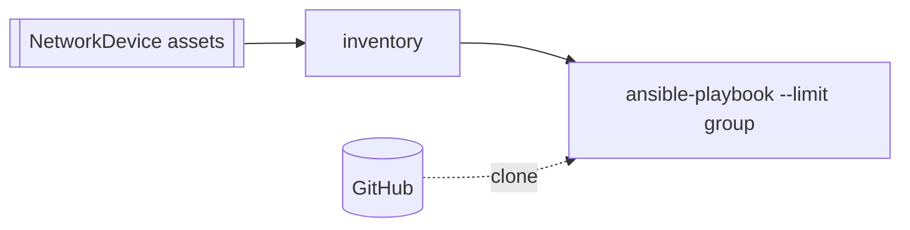

# Ansible Network Automation

> [!IMPORTANT]
> **Kestra Cloud and Kestra Enterprise Edition only (2.0+).** The flows use
> [Assets](https://kestra.io/docs/enterprise/governance/assets) and the `assets()` function,
> which the open-source edition rejects.

This example runs an Ansible playbook from Git against a group of switches. The switches are stored as
Kestra `NetworkDevice` assets, and each asset's `group` metadata is its Ansible inventory group.

| Flow | What it does |
|---|---|
| [`ansible_register_devices`](./flows/ansible_register_devices.yaml) | Registers eight sample Cisco IOS and NX-OS switches as assets, in the groups `amer_switches`, `apac_switches` and `emea_switches`. |
| [`ansible_run_playbook`](./flows/ansible_run_playbook.yaml) | Builds an Ansible inventory from the assets, clones the playbook repo and runs the chosen playbook with `--limit <group>`. |

The playbooks live in [`files/playbooks/network`](./files/playbooks/network):

| Playbook | What it does |
|---|---|
| `precheck.yml` | Read-only. Runs `show version` and publishes each switch's version as a flow output. |
| `base_config.yml` | Pushes NTP and syslog servers. |
| `vlans.yml` | Merges the VLANs in `group_vars/all.yml` onto access switches. |

## What it demonstrates

- **Inventory from assets, not files.** The `group` dropdown is filled from the live assets. Moving a switch to
  another group, or adding one, means changing an asset, not editing an inventory file.
- **Playbooks pulled from Git.** Every run clones the repo at `git_ref`, so a merged playbook change reaches the
  next run without editing the flow.
- **Check mode.** `check_mode` runs the playbook with `--check --diff`.
- **Retries.** A failed playbook run is retried up to 3 times, 15 s apart.
- **Playbook outputs in Kestra.** Values a playbook sets with the `kestra` module become flow outputs.

> [!NOTE]
> On Kestra Cloud, AnsibleCLI runs in a Kubernetes pod, and the plugin does not yet get its outputs file
> back from the pod. The playbook still runs and its output appears in the task logs (`streamLogs: true`),
> but the `results` flow output is empty there. It is filled on Docker and Process task runners.

## Run it on a demo instance

No switches or credentials are needed. **Lab mode** (`simulate: true`, the default) runs the playbook with
`ansible_connection=local`, and each task that would talk to a device logs what it would push instead.

1. Run `ansible_register_devices` in the `solutions.assets` namespace. Check the **Assets** tab.
2. Run `ansible_run_playbook` with the defaults.
3. Try `group: apac_switches` with `playbook: vlans.yml`, then turn on `check_mode`.

To test a branch before it is merged, set `git_ref` to the branch name.

## Going live

| Change | Where |
|---|---|
| Your devices | Register your switches as `NetworkDevice` assets with `group`, `ansible_network_os` and `mgmt_ip` metadata. |
| Device credentials | Create the `NETWORK_SSH_USERNAME` and `NETWORK_SSH_PASSWORD` secrets. They reach Ansible as environment variables, which [`group_vars/all.yml`](./files/playbooks/network/group_vars/all.yml) reads. |
| Your repo | Change `git_url` and `playbook_dir` in `ansible_run_playbook`, and add your playbooks to the `playbook` input. For a private repo, uncomment `username`/`password` on the `clone` task. |
| Real execution | Set `simulate: false`. |

The worker image is `cytopia/ansible:latest-tools`. The `ansible.netcommon`, `cisco.ios` and `cisco.nxos`
collections are installed at runtime and cached. For production, build an image with the collections
and `ansible-pylibssh` already in it, and pin its tag.
