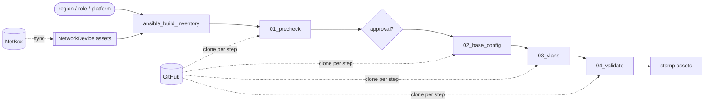

# Ansible Network Automation (AWX → Kestra)

> [!IMPORTANT]
> **Kestra Cloud and Kestra Enterprise Edition only (2.0+).** The flows use
> [Assets](https://kestra.io/docs/enterprise/governance/assets) and the `assets()` function,
> which the open-source edition rejects.

This example runs ordered Ansible playbooks from Git against switches chosen from the Kestra
asset inventory. It is built for network teams moving off AWX. Each AWX building block maps
to a Kestra flow:

| AWX | Kestra | Flow |
|---|---|---|
| Inventory source (NetBox) | `NetworkDevice` assets, synced from NetBox | [`ansible_netbox_device_sync`](./flows/ansible_netbox_device_sync.yaml) |
| Inventory | Subflow that queries the assets and returns an Ansible inventory | [`ansible_build_inventory`](./flows/ansible_build_inventory.yaml) |
| Project + job template | Subflow that clones the repo and runs one playbook, with retries | [`ansible_job_template`](./flows/ansible_job_template.yaml) |
| Workflow template | Ordered playbooks, an approval gate, and asset stamping | [`ansible_switch_rollout`](./flows/ansible_switch_rollout.yaml) |

The playbooks live in [`files/playbooks/switch_rollout`](./files/playbooks/switch_rollout). They are
cloned from GitHub on every run and are never copied into a flow, so a merged playbook change
reaches the next run without anyone editing a flow.

## What it demonstrates

- **Playbooks pulled from Git and run in sequence.** `playbooks` is an ordered list. Each entry runs as its own
  subflow execution, which gives it its own logs and per-host results and lets it be retried on its own. The
  first failure stops the rollout.
- **Inventory from assets, not files.** The run form's dropdowns (region, role, platform) are filled from the
  live assets. Flow authors never write an inventory file, and every switch in the inventory gets its
  asset metadata as host vars.
- **Retries.** Each playbook gets up to 3 attempts, 15 s apart. Turn on `simulate_transient_failure` to see the
  pre-check fail on its first attempt and pass on the second.
- **Dry run.** `dry_run` runs the change playbooks with `--check --diff`, then skips validation and asset stamping.
- **Human in the loop.** `require_approval` pauses after the pre-check, and the change runs only after someone
  approves it.
- **Asset write-back.** After a successful rollout, each switch's asset records `last_rollout`,
  `last_rollout_execution` and `last_rollout_playbooks`. A failed rollout leaves the assets untouched.

## Run it on a demo instance

No switches or credentials are needed. **Lab mode** (`simulate: true`, the default) runs every playbook end
to end with `ansible_connection=local`, and each task that would talk to a device is replaced by a
log line showing what it would push.

1. Run `ansible_netbox_device_sync` with `source: SAMPLE`. This registers eight Cisco IOS and NX-OS
   switches across `amer`, `apac` and `emea`. Check the **Assets** tab.
2. Run `ansible_switch_rollout` with the defaults. The run creates one subflow execution per step, each
   holding its Ansible host results.
3. Try `region: apac` and `role: access-switch`. Then turn on `dry_run`, `require_approval` or
   `simulate_transient_failure`.

To test a branch before it is merged, set `git_ref` to the branch name.

## Going live

| Change | Where |
|---|---|
| Pull real devices | Run `ansible_netbox_device_sync` with `source: NETBOX`, using the `NETBOX_URL` and `NETBOX_API_TOKEN` secrets. Adjust the field mapping in its `devices` task to your NetBox model, especially the `region` and `os_version` custom fields and the platform slugs. |
| Device credentials | Create the `NETWORK_SSH_USERNAME` and `NETWORK_SSH_PASSWORD` secrets. They reach Ansible as environment variables, which [`group_vars/all.yml`](./files/playbooks/switch_rollout/group_vars/all.yml) reads. |
| Point at your repo | Change `git_url` and `playbook_dir` in `ansible_switch_rollout`. For a private repo, uncomment `username`/`password` on the `clone` task. |
| Real execution | Set `simulate: false`. |
| Regional workers | Uncomment `workerSelector` in `ansible_job_template` once a Worker Queue exists for each region. Without a matching queue, a task with a `workerSelector` fails immediately. |

The worker image is `cytopia/ansible:latest-tools`. The `ansible.netcommon`, `cisco.ios` and `cisco.nxos`
collections are installed at runtime and cached. For production, build an image with the collections
and `ansible-pylibssh` already in it, and pin its tag.
