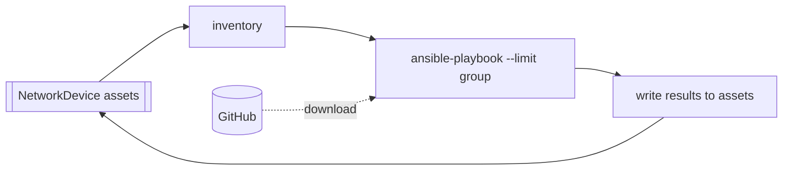

# Ansible Network Automation

> [!IMPORTANT]
> **Kestra Enterprise Edition and Kestra Cloud only (2.0+).** The flows use
> [Assets](https://kestra.io/docs/enterprise/governance/assets) and the `assets()` function,
> which the open-source edition rejects.

This example runs an Ansible playbook from Git against a group of switches and writes the results back to
the switches. The switches are stored as Kestra `NetworkDevice` assets, and each asset's `group` metadata
is its Ansible inventory group.

| Flow | What it does |
|---|---|
| [`ansible_register_devices`](./flows/ansible_register_devices.yaml) | Registers eight sample Cisco IOS and NX-OS switches as assets, in the groups `amer_switches`, `apac_switches` and `emea_switches`. |
| [`ansible_run_playbook`](./flows/ansible_run_playbook.yaml) | Builds an Ansible inventory from the assets, downloads the playbooks from Git, runs the chosen playbook with `--limit <group>`, and writes each switch's result to its asset. |



The playbooks live in [`files/playbooks/network`](./files/playbooks/network):

| Playbook | What it does | Writes to the asset |
|---|---|---|
| `precheck.yml` | Read-only. Runs `show version`. | `os_version` |
| `base_config.yml` | Pushes NTP and syslog servers. | `ntp_servers`, `syslog_hosts` |
| `vlans.yml` | Merges the VLANs in `group_vars/all.yml` onto access switches. | `vlans` |

## What it demonstrates

- **Inventory from assets, not files.** The `group` dropdown is filled from the live assets. Moving a switch to
  another group, or adding one, means changing an asset, not editing an inventory file.
- **Playbooks pulled from Git.** Every run downloads the playbooks at `git_ref`, so a merged playbook change
  reaches the next run without editing the flow.
- **Results written back to the assets.** Every switch the playbook ran on gets these keys on its asset:
  `last_playbook`, `last_playbook_status` (`ok`, `changed`, `failed` or `unreachable`),
  `last_playbook_changed_tasks`, `last_playbook_mode`, `last_playbook_git_ref`, `last_playbook_run` and
  `last_playbook_execution`. The rest of the asset's metadata is kept.
- **Playbooks decide what else is recorded.** A playbook publishes `asset_metadata` with the bundled `kestra`
  module, as a map of host to keys, and the flow writes those keys to each host's asset:

  ```yaml
  - name: Publish asset metadata to Kestra
    kestra:
      outputs:
        asset_metadata: "{{ dict(ansible_play_hosts | zip(ansible_play_hosts | map('extract', hostvars, 'asset_facts'))) }}"
    run_once: true
    delegate_to: localhost
  ```

  `base_config.yml` and `vlans.yml` skip this in check mode, so a dry run never records config it did not push.
- **Check mode.** `check_mode` runs the playbook with `--check --diff`.
- **Retries, and failures on the record.** A failed run is retried up to 3 times, 15 s apart. If it still fails,
  the failed and unreachable switches are written to their assets first, and then the execution fails.

## Run it

No switches or credentials are needed. **Lab mode** (`simulate: true`, the default) runs the playbook with
`ansible_connection=local`, and each task that would talk to a device logs what it would push instead.

1. Run `ansible_register_devices` in the `solutions.assets` namespace. Check the **Assets** tab.
2. Run `ansible_run_playbook` with the defaults. Each switch's asset now shows `os_version` and `last_playbook`.
3. Try `group: apac_switches` with `playbook: vlans.yml`, then turn on `check_mode`.

To test a branch before it is merged, set `git_ref` to the branch name.

### Task runner

AnsibleCLI runs on the **Process** runner, on the worker itself. On first use it creates a virtualenv at
`ansible_venv` (`/tmp/kestra-ansible-venv`) with `uv`, which the Kestra image ships, and installs `ansible` and
`ansible-pylibssh` into it. The `ansible` package bundles the `cisco.ios`, `cisco.nxos` and `ansible.netcommon`
collections, so nothing is downloaded from Galaxy. To change the package list, delete the virtualenv, or
point `ansible_venv` at a new path.

To run in a container instead, see the comment on the `playbook` task. On Kestra Cloud the default runner is
Kubernetes. There, the plugin does not yet get its outputs file back from the pod, so the playbook runs, but
no results reach the assets.

## Going live

| Change | Where |
|---|---|
| Your devices | Register your switches as `NetworkDevice` assets with `group`, `ansible_network_os` and `mgmt_ip` metadata. |
| Device credentials | Create the `NETWORK_SSH_USERNAME` and `NETWORK_SSH_PASSWORD` secrets. They reach Ansible as environment variables, which [`group_vars/all.yml`](./files/playbooks/network/group_vars/all.yml) reads. |
| Your repo | Change `git_url` and `playbook_dir` in `ansible_run_playbook`, and add your playbooks to the `playbook` input. For a private repo, add the `Authorization` header shown on the `playbook` task. |
| Real execution | Set `simulate: false`. |

> [!NOTE]
> Keep the playbook task out of a `WorkingDirectory`. On Kestra 2.0.8, a retried task inside a
> `WorkingDirectory` leaves the execution `RUNNING` once its attempts run out.
