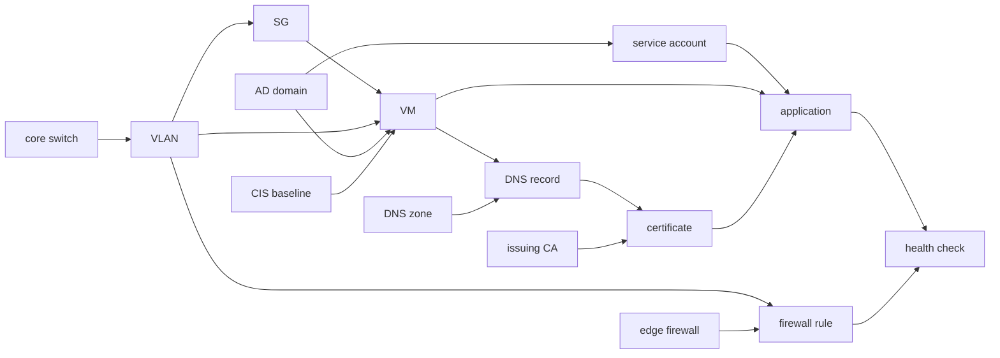

# kestra4infra: a deployment as a graph of assets

End-to-end provisioning of an application deployment on Kestra 2.1 (tenant `solutions`, namespace
`solutions.kestra4infra`), built so every resource it creates is an asset, connected to the others.
On top of that graph: day-2 actions on each asset, asset lifecycle triggers, and blast radius.

Only the TLS certificate is real (openssl). The VM, network, DNS, AD, firewall, Ansible and
application steps log what they would do and record the asset; the production task (Terraform,
AnsibleCLI, NetBox, PowerShell, HTTP) sits in a comment under each one.

### What gets built
`provision_deployment` (form: app, env, servers, size, owner, cost center, change ticket, lease,
certificate validity, password age):

| # | Step | Asset | Depends on (lineage) |
|---|---|---|---|
| 1 | Register the deployment | `Deployment` (TTL = lease) | |
| 2 | VLAN and subnet on the core switch | `NetworkSegment` | core switch |
| 3 | Security group | `SecurityGroup` | VLAN |
| 4 | Rule on the edge firewall | `FirewallRule` | edge firewall, VLAN |
| 5 | Service account in AD | `ServiceAccount` (TTL = password expiry) | AD domain |
| 6 | One VM per server (Terraform) | `VM` | VLAN, SG |
| 7 | AD join, CIS hardening (Ansible) | VM metadata | AD domain, CIS baseline |
| 8 | Application install | `Application` | each VM, service account |
| 9 | DNS A record | `DnsRecord` | each VM, DNS zone |
| 10 | TLS certificate (real openssl) | `Certificate` (TTL = notAfter) | DNS record, issuing CA |
| 11 | Certificate install | Application metadata | certificate |
| 12 | Health check | `HealthCheck` | application, firewall rule |

Every resource is `partOf` the deployment. The shared infrastructure (`setup_shared_infra`: core
switch, edge firewall, DNS zone, AD domain, issuing CA, CIS baseline) belongs to no deployment, which
is why its blast radius crosses deployments.



### Metadata worth querying
- **Expiries as TTL** (drive triggers and the expiry views): deployment lease, certificate notAfter, service account password, issuing CA.
- **Expiries as metadata** (for audits and reports): `account_expires_at` (account ends with the lease), `os_eol`, `license_expires_at`, firewall `recertify_by`, security group `review_due`, switch `support_contract_expires`.
- **Ownership and cost:** `owner`, `cost_center`, `change_ticket`, `requested_by`, `data_classification`, `rto`.
- **Configuration state:** `config_baseline`, `config_applied_at`, `config_drift`, `cmdb_ci`, `monitoring`, `backup_policy`, `patch_group`.
- **Certificate detail:** serial, previous serial, SHA-256 fingerprint, SANs, issuer, link to the PEM.

### Day-2 actions (buttons on the asset)
| Asset | Actions |
|---|---|
| Deployment | Blast radius, Extend lease, Decommission |
| VM | Resize, Re-apply configuration, Blast radius |
| Certificate | Renew certificate (real openssl), Blast radius |
| Service account | Rotate password, Blast radius |
| Application | Run health check, Blast radius |
| Health check | Run health check |
| VLAN, SG, firewall rule, DNS, shared infra | Blast radius |

`decommission_deployment` reads the deployment's children from the inventory and removes them last
built first (health check, certificate, DNS, application, servers, account, rule, SG, VLAN).

### Catalog apps
One Execution app per user-facing flow, `catalog: true`, tagged `kestra4infra` (`apps/`, generated by
`scripts/gen_apps.py`, deployed by `scripts/deploy_apps.sh`). Each one: the flow's form on open, a live Gantt
while it runs, the resulting assets (or the report, for blast radius) on success, the error on failure.

| App | Flow | Tag |
|---|---|---|
| Request an application deployment | `provision_deployment` | provisioning |
| Register the shared infrastructure | `setup_shared_infra` | admin |
| Blast radius of an asset | `blast_radius` | risk |
| Renew a TLS certificate | `renew_certificate` | day-2, security |
| Rotate a service account password | `rotate_service_account` | day-2, security |
| Resize a server | `resize_vm` | day-2, compute |
| Re-apply the server baseline | `reapply_configuration` | day-2, compliance |
| Check an application | `run_health_check` | day-2, operations |
| Extend a deployment lease | `extend_lease` | day-2, governance |
| Decommission a deployment | `decommission_deployment` | retirement |

The trigger flows have no app: nobody requests them.

### Asset triggers
| Flow | Trigger | What happens |
|---|---|---|
| `on_vm_created` | `EventTrigger` CREATED on VM | CMDB CI, monitoring, backup enrolment. Provisioning does not know it exists |
| `health_degraded_blast_radius` | `EventTrigger` UPDATED on HealthCheck, `health = degraded` | runs `blast_radius` on the application: suspects upstream, impact downstream, teams to page |
| `cert_expiry_autorenew` | `TtlTrigger` EXPIRING P15D on Certificate | `renew_certificate`, then a health check |
| `service_account_autorotate` | `TtlTrigger` EXPIRING P7D on ServiceAccount | `rotate_service_account`, application restart |
| `deployment_lease_expired` | `TtlTrigger` EXPIRED on Deployment | flags `lease_alert: overdue`; teardown left in a comment |

TTL triggers are evaluated by the platform's TTL check, **every hour by default**
(`kestra.assets.ttl-check.fixed-delay`, `PT1H`; first check 1 minute after start). For a live demo,
set it shorter in `application.yaml` and restart:
```yaml
kestra:
  assets:
    ttl-check:
      fixed-delay: PT1M
```

### Demo script
1. `setup_shared_infra` (once), then `provision_deployment` with the defaults: `orders-prod`, 2 servers. Open the deployment: 11 resources, their actions, their metadata. Open a VM's Dependencies tab.
2. `provision_deployment` with `app=billing env=uat vm_count=1 cert_validity_days=10 password_max_age_days=5`. `on_vm_created` fires at once; at the next TTL check, the certificate renews and the password rotates on their own.
3. Blast radius on `k4i-issuing-ca` or `k4i-core-sw-01`: both deployments, the teams to call.
4. `run_health_check` on `orders-prod-app` with `outcome=degraded`: the incident flow starts on its own with suspects and impact. Run it again with `healthy` afterwards.
5. Decommission a deployment: the teardown order follows the graph.

Story beats: the asset is the unit of automation (actions live on it as well as in the catalog);
lifecycle dates are TTLs, so expiry is an event, not a scan; the graph is recorded by the tasks that
build things, so blast radius and teardown order are free.

### Run it
```bash
# From this folder. Targets a Kestra 2.1 EE instance (default http://localhost:18080, tenant solutions).
export KESTRA_AUTH='user@example.com:password'   # KESTRA_URL and TENANT override the defaults
scripts/deploy.sh                 # create or update every flow
scripts/deploy_apps.sh            # create or update the catalog apps
scripts/run.sh setup_shared_infra
scripts/run.sh provision_deployment app=orders env=prod
scripts/run.sh blast_radius asset=k4i-issuing-ca
```
`blast_radius` calls the asset graph API at `http://localhost:8080` (the webserver seen from the worker)
as `admin@localhost.dev`, with the namespace secret `KESTRA_API_PASSWORD`. Change both for another instance.

Not for the cloud deploy of this repo: it needs Kestra 2.1 (asset triggers, custom asset types) and
the Process task runner (the certificate step).

### Gotchas met while building it
- `trigger.asset` from `EventTrigger` has no `partOf`; ids carry the deployment prefix instead.
- A templated asset `type` (`"{{ item.value.type }}"` in a Loop) failed the run, so teardown is one step per type.
- `OutputValues` stores values as JSON text: `fromJson()` before `join` or a loop, and no `toJson` when splicing a list into a jq program.
- A jq error inside Pebble always reads `Unable to parse jq value ...` whatever the cause; the real cause is in the DEBUG stack (`Caused by: ...JsonQueryException`).
