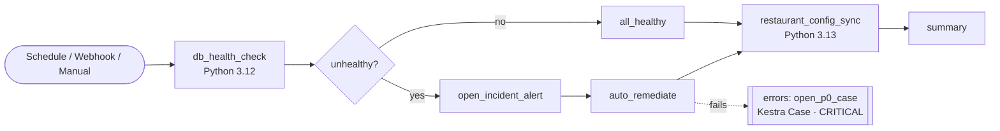

# SRE Incident Response

> [!IMPORTANT]
> **Kestra Cloud and Kestra Enterprise Edition only (2.0+).** This flow opens incidents with
> [Cases](https://kestra.io/docs/enterprise/governance/cases), an Enterprise feature. The
> `io.kestra.plugin.kestra.ee.cases.CreateCase` task is rejected in the open-source edition.

Flow: [`flows/sre_incident_response.yaml`](./flows/sre_incident_response.yaml) (namespace `solutions.ops`)

This flow is a single demo of the SRE automation that teams usually run in a legacy runbook tool. Examples are Azure Automation, Rundeck, or cron scripts on a shared box. It covers:

1. **Monitoring:** scheduled database health checks, with retries and per-database latency metrics.
2. **Incident response:** if a check fails, it opens an alert in the team's incident tool and tries an automatic fix.
3. **Data sync:** it syncs restaurant (or store) configuration into the incident tool to enrich alerts. The sync is written in Python.
4. **Escalation:** if anything fails, it opens a **P0 Case in Kestra**. The case has CRITICAL severity, SLAs, the error logs, and links to the failed execution.
5. **Triggers:** an hourly schedule, plus a webhook that monitoring tools can call without needing an inbound firewall rule.

Each Python task runs in its own container, with its own pinned dependencies and Python version. The flow uses Python 3.12 and 3.13 side by side. This answers a common complaint: "our runbook workers are stuck on an old Python, and dependencies have to be installed on the box".



Nothing in the flow calls a real external system. The database checks are simulated, and the incident-tool calls run as dry runs that log the payload they would send. So the flow runs anywhere without credentials, apart from the Kestra API token described below.

---

## Prerequisites

| Requirement | Why |
|---|---|
| Kestra **Cloud**, or Kestra **EE 2.0 or later** | Cases and `CreateCase` only exist in these editions. |
| [Kestra plugin](https://kestra.io/plugins/plugin-kestra) installed | Provides `CreateCase`. It ships with Cloud and with the default EE image. If you manage plugins yourself, install it through Versioned Plugins. |
| A container task runner (EE self-hosted only) | The Python tasks set `containerImage`, so workers need Docker or Kubernetes. Kestra Cloud already provides this. |
| A Kestra API token stored as a secret | `CreateCase` calls the Kestra API to open the case. See the next section. |

## Setup

### 1. Create an API token

`CreateCase` calls the Kestra API, so it needs credentials. If you skip this step, the `open_p0_case` task fails with **`401 Authentication required`**.

Use a **service account**, not a personal API key. Otherwise every case shows up as opened by one person, and the flow breaks when that person leaves.

1. Go to **Administration → IAM → Service Accounts** and create one, for example `sre-automation`.
2. Give it a role with these **`CASE`** permissions on the `solutions.ops` namespace:
   - `CREATE`, to open a case
   - `UPDATE`, to link later failures to an open case
   - `VIEW`
3. Generate an API token for the service account and copy it.

### 2. Store the token as a secret

Go to **Namespaces → `solutions.ops` → Secrets → Add** and create:

| Key | Value |
|---|---|
| `KESTRA_API_TOKEN` | the token from step 1 |

The flow reads it with:

```yaml
auth:
  apiToken: "{{ secret('KESTRA_API_TOKEN') }}"
```

You can also put the secret on a parent namespace, such as `solutions`, so that other flows can share it.

> [!TIP]
> **Alternative:** an admin can set **Default authentication credentials** on the namespace or tenant, when editing it. `CreateCase` then authenticates without any configuration on the task, and you can delete the `auth:` block from the flow.

### 3. Deploy the flow

- **From this repo:** a merge to `main` deploys to the CS Cloud instance automatically.
- **Anywhere else:**
  - In the UI, open **Flows → Create** and paste the YAML.
  - From the API:

```bash
curl -X POST "https://<your-kestra>/api/v1/<tenant>/flows" \
  -H "Authorization: Bearer $KESTRA_API_TOKEN" \
  -H "Content-Type: application/x-yaml" \
  --data-binary @flows/sre_incident_response.yaml
```

On Kestra Cloud, the tenant is usually `main`.

### 4. (Optional) Point it at the customer's incident tool

All the incident-tool settings are in one variable block:

```yaml
variables:
  incident_tool:
    name: Incident Tool                                   # e.g. BigPanda, PagerDuty, Opsgenie, ServiceNow
    alerts_url: https://incident-tool.example.com/api/v1/alerts
    source_key: sre-kestra-demo
```

### 5. Triggers

| Trigger | Default | Notes |
|---|---|---|
| `hourly_health_check` | **disabled** | Enable it in the UI during the demo. It's off by default so it doesn't use up executions. |
| `alert_webhook` | enabled | `POST https://<your-kestra>/api/v1/<tenant>/executions/webhook/solutions.ops/sre_incident_response/sre-demo-7f3c9a` |

Change the webhook `key` before using the flow outside a demo instance. Anyone who knows the key can trigger the flow.

---

## Running the demo

All three scenarios are driven by inputs in the **Execute** form:

| Scenario | Inputs | What happens |
|---|---|---|
| **Healthy** | defaults | All 5 databases pass, then the `all_healthy` branch and the config sync run. |
| **Incident, auto-remediated** | `Simulate a degraded database` = on | `orders-db` fails its check. The flow opens an alert in the incident tool, `auto_remediate` succeeds, and the execution ends in SUCCESS. |
| **P0 escalation** | also turn on `Simulate failed auto-remediation` | `auto_remediate` fails. The `errors` block runs `open_p0_case`, and a **CRITICAL** case appears under **Cases** with the details below. |

The P0 case includes:

- **Title:** `[P0] sre_incident_response failed in prod`
- **SLAs:** acknowledge within 15 minutes, resolve within 4 hours
- **Description (Markdown):**
  - the flow and a link to the execution
  - the environment and start time
  - the failed tasks
  - the unhealthy databases, with latency and connection counts
  - the error logs
  - next steps
- **Custom fields:** `priority: P0`, `team: sre`, and `environment`
- **Deduplication:** `linkMatchingExecutions: true`, so repeated failures attach to the case that's already open instead of opening a new one.

**Things to show during the demo:**
- **Topology view:** watch the `If` branch take a different path in each scenario.
- **Logs** for `db_health_check`: the `Python 3.12.x` line, next to the 3.13 sync task.
- **Outputs → `incident_tool_enrichment.json`** from the sync task.
- **Cases → board view:** move the case from Open to Acknowledged to Resolved, and watch the SLA countdown.

## Taking it to production

| Demo piece | Production replacement |
|---|---|
| Simulated health checks | Use `io.kestra.plugin.jdbc.*.Query` tasks, or keep the Python and query the real databases. |
| Dry-run incident alert | Uncomment `requests.post(...)` and read the tool's API key with `secret()`. |
| Simulated remediation | Use real runbook steps: SQL, `kubectl`, cloud CLI, or Ansible. |
| Inline Python | Move the scripts into Git and load them with namespace files or `git.SyncNamespaceFiles`. |

## Troubleshooting

| Symptom | Fix |
|---|---|
| `open_p0_case` fails with `401 Authentication required` | `KESTRA_API_TOKEN` is missing or invalid, or no default credentials are set. Go back to Setup steps 1 and 2. |
| `open_p0_case` fails with `403` | The service account is missing `CASE` `CREATE` or `UPDATE` on the namespace. |
| `Cannot find secret KESTRA_API_TOKEN` | The secret was created in a different namespace. Create it on `solutions.ops` or a parent namespace. |
| `Unrecognized field "pluginDefaults"` when deploying | You're deploying an older copy to Kestra 2.0. This flow doesn't use `pluginDefaults`, so redeploy from this file. |
